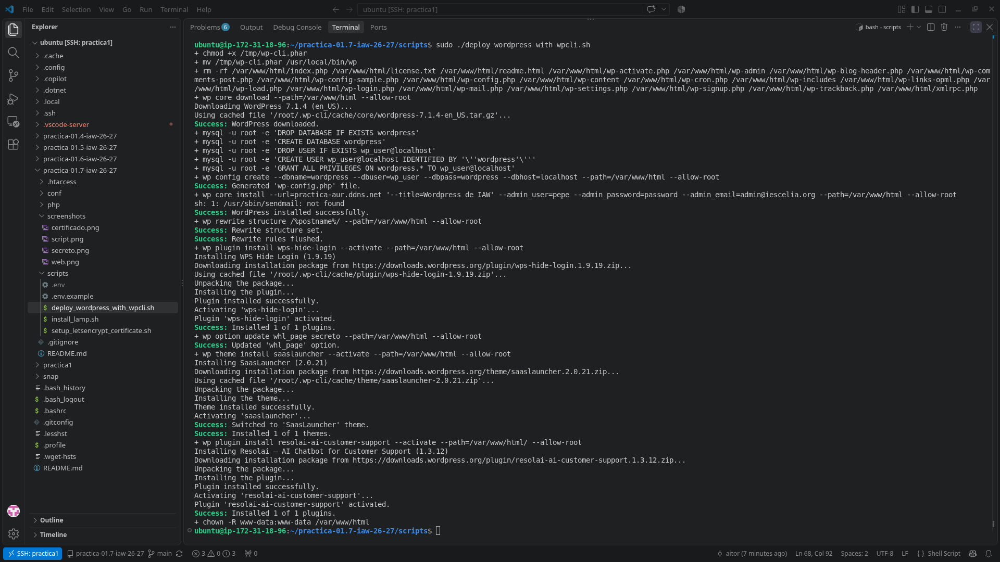
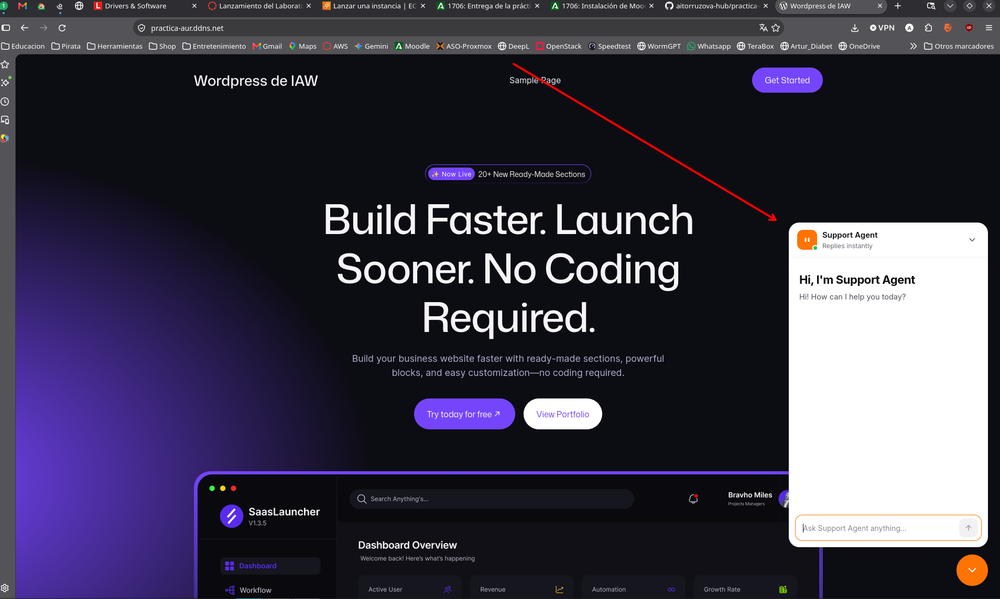
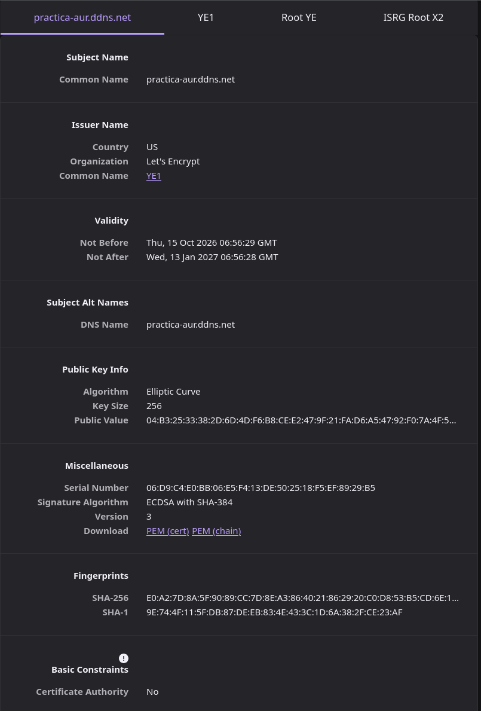
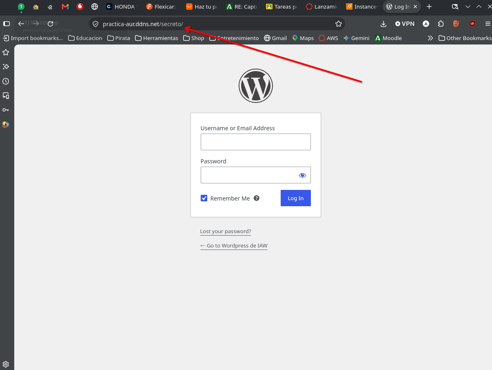

# Práctica 1.7: Despliegue Automatizado de WordPress mediante WP-CLI sobre LAMP con HTTPS

## Introducción y Objetivos

El objetivo principal de esta práctica es automatizar completamente el despliegue de un sitio web funcional con **WordPress** sobre un servidor **LAMP** (Linux, Apache, MySQL, PHP).

Para optimizar este proceso y evitar la configuración manual a través de la interfaz web, se usa **WP-CLI**, una herramienta de línea de comandos oficial de WordPress. Además, aseguramos el tráfico del sitio implementando un certificado SSL/TLS válido mediante **Let's Encrypt** y **Certbot**, y aplicamos medidas de seguridad básicas ocultando la URL por defecto del panel de administración (`wp-admin`).

## Requisitos Previos

Antes de ejecutar los scripts de automatización, el servidor debe cumplir con los siguientes requisitos:

1. Un sistema operativo basado en **Debian/Ubuntu** con acceso a privilegios de superusuario (`sudo`).

2. Un nombre de **dominio apuntando hacia la dirección IP pública del servidor** (necesario para la validación del certificado por parte de Let's Encrypt).

3. Puertos **80 (HTTP)** y **443 (HTTPS)** abiertos en el cortafuegos.

## Estructura del Repositorio

La arquitectura del proyecto está organizada de forma modular separando configuraciones, scripts de despliegue y archivos estáticos:

```
.
├── conf/
│   ├── 000-default.conf                # VirtualHost base para peticiones HTTP
│   └── virtualhost.conf.template       # Plantilla dinámica para el dominio con HTTPS/SSL
├── .gitignore                          # Exclusión de archivos sensibles (.env)
├── .htaccess/
│   └── .htaccess                       # Reglas de reescritura para permalinks
├── php/
│   └── index.php                       # Comprobación del motor PHP info
├── README.md                           # Documentación técnica del proyecto
├── screenshots/                        # Evidencias visuales del funcionamiento
│   ├── certificado.png
│   ├── script.png
│   ├── secreto.png
│   └── web.png
└── scripts/
    ├── .env.example                    # Plantilla de variables de entorno
    ├── install_lamp.sh                 # Paso 1: Instalación del stack LAMP
    ├── setup_letsencrypt_certificate.sh# Paso 2: Configuración del SSL con Certbot
    └── deploy_wordpress_with_wpcli.sh  # Paso 3: Despliegue automatizado con WP-CLI
```

## Guía de Despliegue Paso a Paso

Para reproducir este despliegue desde cero, se deben seguir los siguientes pasos en orden secuencial:

### Paso 0: Configuración de Variables de Entorno

Antes de lanzar la automatización, es imprescindible crear el archivo `.env` en la carpeta `scripts/` copiando la plantilla `.env.example`. Este archivo centraliza la configuración sensible para que los scripts no contengan contraseñas en duro.

```
cd scripts/
cp .env.example .env
nano .env
```

Define los valores reales del dominio, base de datos y credenciales de administración dentro de `.env`:

* `LETS_ENCRYPT_DOMAIN`: Tu dominio configurado (ej. `mi-dominio.com`).

* `LETS_ENCRYPT_EMAIL`: Tu correo de contacto para Let's Encrypt.

* `WORDPRESS_DB_NAME`, `WORDPRESS_DB_USER`, `WORDPRESS_DB_PASSWORD`: Credenciales parala base de datos.

* `WORDPRESS_ADMIN_USER`, `WORDPRESS_ADMIN_PASSWORD`, `WORDPRESS_ADMIN_EMAIL`: Credenciales del usuario root de WordPress.

* `WORDPRESS_LOGIN_URL`: Slug o ruta personalizada para la URL secreta de login (ej. `secreto`).

### Paso 1: Instalación del Stack LAMP (`scripts/install_lamp.sh`)

Este script se encarga del aprovisionamiento base del servidor instalando Apache2, PHP con sus extensiones necesarias para MySQL, y el gestor de bases de datos MySQL Server.

```
#!/bin/bash
set -ex

# 1. Actualización del índice de paquetes
apt update

# 2. Instalación del servidor web Apache
sudo apt install apache2 -y

# 3. Copia del VirtualHost inicial (HTTP)
cp ../conf/000-default.conf /etc/apache2/sites-available/

# 4. Activación del módulo de reescritura de URLs en Apache
sudo a2enmod rewrite

# 5. Instalación de PHP y su módulo para Apache y MySQL
sudo apt install php libapache2-mod-php php-mysql -y

# 6. Reinicio del servicio para aplicar cambios
systemctl restart apache2

# 7. Copia del script de verificación de PHP
cp ../php/index.php /var/www/html

# 8. Asignación de permisos al directorio web raíz
sudo chown -R www-data:www-data /var/www/html

# 9. Instalación del servidor de base de datos MySQL
sudo apt install mysql-server -y

```

**¿Por qué se hace así?**

Se habilita el módulo `mod_rewrite` desde esta fase previa porque WordPress depende de él para estructurar las rutas amigables y permalinks en archivos `.htaccess`.

### Paso 2: Emisión del Certificado SSL (`scripts/setup_letsencrypt_certificate.sh`)

Una vez levantado el servidor web, configuramos el VirtualHost definitivo y solicitamos a la entidad emisora **Let's Encrypt** el certificado seguro a través del cliente oficial **Certbot**.

```
#!/bin/bash
set -ex

# 1. Carga de variables del archivo .env
set -a
source .env

# 2. Instalación de snapd y actualización del núcleo
sudo snap install core
sudo snap refresh core

# 3. Limpieza de versiones previas de certbot instaladas mediante apt
sudo apt remove certbot -y

# 4. Instalación de Certbot en modo clásico mediante Snap
sudo snap install --classic certbot
sudo ln -fs /snap/bin/certbot /usr/local/bin/certbot

# 5. Deshabilitación de los VirtualHosts por defecto
a2dissite 000-default.conf
a2dissite default-ssl.conf

# 6. Generación del VirtualHost final sustituyendo variables dinámicas ($LETS_ENCRYPT_DOMAIN y $LETS_ENCRYPT_EMAIL)
envsubst '$LETS_ENCRYPT_DOMAIN ${LETS_ENCRYPT_EMAIL}' < ../conf/virtualhost.conf.template > /etc/apache2/sites-available/${LETS_ENCRYPT_DOMAIN}.conf

# 7. Activación del nuevo sitio y recarga de Apache
a2ensite ${LETS_ENCRYPT_DOMAIN}.conf
sudo systemctl reload apache2

# 8. Solicitud automatizada e instalación del certificado SSL/TLS
sudo certbot --apache -m $LETS_ENCRYPT_EMAIL --agree-tos --no-eff-email -d $LETS_ENCRYPT_DOMAIN --non-interactive

```

**¿Por qué se hace así?**

Utilizamos `envsubst` para inyectar dinámicamente el nombre del dominio dentro de la plantilla `conf/virtualhost.conf.template`. El parámetro `--non-interactive` de Certbot permite realizar la emisión en segundo plano dentro del script sin requerir confirmaciones manuales por teclado.

### Paso 3: Despliegue de WordPress con WP-CLI (`scripts/deploy_wordpress_with_wpcli.sh`)

Este es el script central de la práctica. En lugar de instalar WordPress descargando un archivo zip y rellenando formularios web, usamos la herramienta **WP-CLI** para automatizar el aprovisionamiento, la creación del archivo `wp-config.php`, la instalación del núcleo, la aplicación de temas, plugins y la personalización de la URL de administración.

```
#!/bin/bash
set -ex

# 1. Importación del entorno
source .env

# 2. Descarga e instalación global de la herramienta WP-CLI
rm -rf /tmp/wp-cli.*
wget https://raw.githubusercontent.com/wp-cli/builds/gh-pages/phar/wp-cli.phar -P /tmp/
chmod +x /tmp/wp-cli.phar
mv /tmp/wp-cli.phar /usr/local/bin/wp

# 3. Limpieza de instalaciones previas en el DocumentRoot
rm -rf /var/www/html/*

# 4. Descarga automatizada del código fuente de WordPress
wp core download \
  --path=/var/www/html \
  --allow-root

# 5. Creación de la base de datos y usuario dedicado en MySQL
mysql -u root -e "DROP DATABASE IF EXISTS $WORDPRESS_DB_NAME"
mysql -u root -e "CREATE DATABASE $WORDPRESS_DB_NAME"
mysql -u root -e "DROP USER IF EXISTS $WORDPRESS_DB_USER@$IP_CLIENTE_MYSQL"
mysql -u root -e "CREATE USER $WORDPRESS_DB_USER@$IP_CLIENTE_MYSQL IDENTIFIED BY '$WORDPRESS_DB_PASSWORD'"
mysql -u root -e "GRANT ALL PRIVILEGES ON $WORDPRESS_DB_NAME.* TO $WORDPRESS_DB_USER@$IP_CLIENTE_MYSQL"

# 6. Generación del archivo wp-config.php con los parámetros de conexión
wp config create \
  --dbname=$WORDPRESS_DB_NAME \
  --dbuser=$WORDPRESS_DB_USER \
  --dbpass=$WORDPRESS_DB_PASSWORD \
  --dbhost=$WORDPRESS_DB_HOST \
  --path=/var/www/html \
  --allow-root

# 7. Instalación del CMS y creación del usuario administrador
wp core install \
  --url=$LETS_ENCRYPT_DOMAIN \
  --title="$WORDPRESS_TITLE" \
  --admin_user=$WORDPRESS_ADMIN_USER \
  --admin_password=$WORDPRESS_ADMIN_PASSWORD \
  --admin_email=$WORDPRESS_ADMIN_EMAIL \
  --path=/var/www/html \
  --allow-root
  
# 8. Configuración del esquema de URLs permanentes (Permalinks amigables)
wp rewrite structure '/%postname%/' \
  --path=/var/www/html \
  --allow-root

# 9. Instalación y activación del plugin de seguridad WPS Hide Login
wp plugin install wps-hide-login --activate --path=/var/www/html --allow-root

# 10. Modificación de la opción para ocultar la ruta por defecto /wp-admin
wp option update whl_page "$WORDPRESS_LOGIN_URL" --path=/var/www/html --allow-root

# 11. Instalación y activación del tema 'saaslauncher'
wp theme install saaslauncher --activate --path=/var/www/html --allow-root

# 12. Instalacion y activacion del plugin de resolai 
wp plugin install resolai-ai-customer-support --activate --path=/var/www/html/ --allow-root

# 13. Asignación final de permisos al usuario del servidor web
chown -R www-data:www-data /var/www/html

```

## Verificación y Evidencias de Funcionamiento

A continuación se detallan las verificaciones realizadas para asegurar que el despliegue automático ha concluido con éxito:

### 1. Salida y Ejecución Correcta del Script

Muestra la ejecución completa del script `deploy_wordpress_with_wpcli.sh` sin errores de sintaxis ni fallos en la conexión con MySQL o WP-CLI (`set -ex` activado).

   

* Certifica la correcta descarga de paquetes, la preparación de MySQL y la finalización exitosa de los comandos de WP-CLI en la consola.

### 2. Acceso a la Web Pública de WordPress 

Visualización de la página principal del sitio web desplegado accediendo mediante el nombre de dominio configurado y visualizacion del plugin resolai.

   

*  WordPress está ejecutandose utilizando el tema **saaslauncher** activado automáticamente mediante los comandos de WP-CLI.

### 3. Validación de la Conexión Segura HTTPS/SSL 

Inspección del certificado SSL desde la barra del navegador comprobando la entidad emisora.

   

* El protocolo HTTPS funciona correctamente, la conexión está cifrada de extremo a extremo y el certificado SSL ha sido renovado/emitido por una CA válida.

### 4. Acceso al Login Secreto/Personalizado 

Intento de acceso utilizando la URL personalizada configurada mediante el plugin `wps-hide-login` a través de WP-CLI (`$WORDPRESS_LOGIN_URL`).

   

* El acceso estándar a `wp-admin` o `wp-login.php` ha funcionado correctamente y nos deja entrar con nuestras credenciales definidas en el .env.

## Problemas Encontrados y Soluciones Aplicadas

* **Error 404 al acceder a permalinks personalizados:**

Al activar el esquema de permalinks `/%postname%/`, las páginas secundarias devolvían un error 404 de Apache para ello hay que revisar que el modulo `mod_rewrite` estuviese activo (`a2enmod rewrite`) y se añadir la directiva `AllowOverride All` dentro de la sección `<Directory /var/www/html>` en el archivo de plantilla `virtualhost.conf.template`.

* **Conflicto de permisos en el directorio `/var/www/html` al ejecutar WP-CLI:**

Al descargar los archivos e instalar plugins como `root`, los archivos pertenecían a este usuario y WordPress no permitía subir imágenes ni actualizar plugins desde el panel de control. Se incluyó al final del script la instrucción de cambio de propietario recursivo `chown -R www-data:www-data /var/www/html`.
